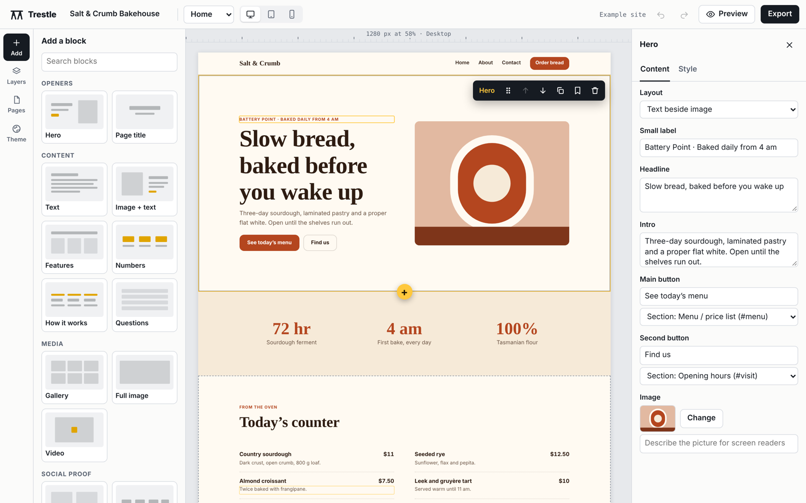

# Trestle

A modular website builder that runs entirely in your browser. Stack ready-made blocks, type straight onto the page, pick a theme, then export a finished website made of plain HTML and CSS that you can host anywhere.

No accounts, no server and no build step. Your sites are saved in your own browser.



## What it does

- **Templates that set themselves up** — pick a café, trades, portfolio, classes, learning hub or blank template, enter your business name and logo (plus optional phone, email and town), and every page is filled in for you. Trestle can also match the theme colour to your logo.
- **27 blocks** — heroes (with star ratings), text, image + text, features, numbers, badges, progress bars, how it works, gallery, image cards, full-width image, video, testimonials, partners, team, profile, comments, share buttons, menu / price list, pricing, call to action, questions, opening hours, contact form, map, divider, custom code, and a "Build your own" columns block.
- **Section styling** — background tones, slanted top or bottom edges, and a peeking image (such as a mascot) that pokes in from the side of any section.
- **Footer columns** — link columns, a newsletter sign-up and social links.
- **Edit in place** — click text on the page and type. Select words in paragraphs to make them bold, italic or a link.
- **Drag and drop** — drag blocks from the library onto the page, reorder them on the canvas or in Layers, duplicate them, and save favourites to *My blocks*.
- **Multiple pages** — each with its own web address and search engine title and description. The header and footer repeat on every page.
- **Themes** — 8 presets, or set your own colours, fonts, corner radius and text size. Colour contrast is checked as you go.
- **Responsive** — preview at desktop, tablet and phone widths. Hide a block on phones or on desktop.
- **Images** — upload your own (resized to 1800 px and stored as WebP), use an image address, or use the built-in artwork that recolours itself to your theme.
- **Undo and redo**, autosave, and backups you can download and import.
- **Export** — a zip containing one HTML file per page, a shared `styles.css`, your images and, if you give your site address, a `sitemap.xml`. A checklist flags leftover placeholder text, sample testimonials and images without descriptions before you publish.

## Use it

Open the GitHub Pages link for this repository, or run it on your own computer:

```bash
git clone https://github.com/mteck776-debug/trestle.git
cd trestle
python3 -m http.server 8000
```

Then open <http://localhost:8000>. Opening `index.html` directly also works in most browsers.

### Keyboard shortcuts

| Keys | Action |
| --- | --- |
| Ctrl Z / Ctrl Y | Undo / redo |
| Ctrl D | Duplicate the selected block |
| Delete | Remove the selected block |
| Alt ↑ / Alt ↓ | Move the selected block |
| Esc | Deselect, or close a dialog |

## Publishing a site you made

1. Click **Export**, then **Download website (.zip)**.
2. Unzip it and upload the folder to any static host: GitHub Pages, Netlify, Cloudflare Pages or your own web space.
3. Contact forms open the visitor's email app by default. To receive messages directly, paste a form service address (for example from Formspree) into the contact block's settings.

## Hosting Trestle on GitHub Pages

This repository includes a workflow at `.github/workflows/pages.yml` that publishes the editor whenever you push to `main`.

1. Go to **Settings → Pages**.
2. Under **Build and deployment**, set **Source** to **GitHub Actions**.
3. Push to `main`, or run the workflow from the **Actions** tab. The address appears on the Pages settings screen.

## How the code is laid out

| File | What it holds |
| --- | --- |
| `index.html` | The editor's page structure |
| `src/editor.css` | Styles for the editor itself |
| `src/site.js` | Fonts, themes, the artwork generator and the CSS every exported site ships with |
| `src/blocks.js` | The block library and starter templates. Each block lists its defaults, its settings fields and how it renders |
| `src/app.js` | Editor state, canvas, panels, undo, saving and export |

### Adding a block

Add an entry to `BLOCKS` in `src/blocks.js`:

```js
quote: {
  name: 'Big quote', group: 'Content', desc: 'One large pull quote',
  thumb: '8 10 44 4;8 17 36 4;8 25 14 2a',   // library thumbnail: "x y width height" rectangles
  style: { pad: 'l', align: 'c' },
  def: { text: 'Something worth repeating.', who: 'Name' },
  fields: [ { k: 'text', label: 'Quote', type: 'textarea' }, { k: 'who', label: 'Who said it' } ],
  render: (p, c) => `<div class="wrap">${c.t('text', 'blockquote', 'quote')}${c.t('who', 'p', 'mut')}</div>`
}
```

`c.t()` renders editable text, `c.r()` rich text, `c.img()` an image and `c.btn()` a button. The same renderer drives the editor, the preview and the export. Field types are `text`, `textarea`, `toggle`, `select`, `range`, `link`, `button`, `image` and `list`.

## Notes

- Sites live in your browser's storage (IndexedDB). Clearing site data removes them, so download a backup from **Export** now and then.
- Maps, videos and custom code show a stand-in while editing and work on the exported site.
- Comment and newsletter boxes need a form service address (such as Formspree or Mailchimp), because a site made of plain files can't store submissions itself. Without one they're left off the exported site.
- The sample businesses in the templates are made up.

## Licence

MIT. See [LICENSE](LICENSE).
